# worxpad

A wireless macropad on its own PCB in a CNC aluminium case. 16 low-profile keys, two knobs with push, two round
buttons, a 240 x 240 colour display, USB-C and Bluetooth to four hosts, a 1,200 mAh battery. Board, case and
firmware are generated from code in this repository and checked against one shared file,
[`board.toml`](board.toml).

It has the function set of the Prota Designs GLYF, which serves as a reference only. Nothing of the GLYF's
name, artwork, firmware or files is used. Where worxpad differs, and why, is in
[Compared with the GLYF](#compared-with-the-glyf) and [docs/reference-device.md](docs/reference-device.md).

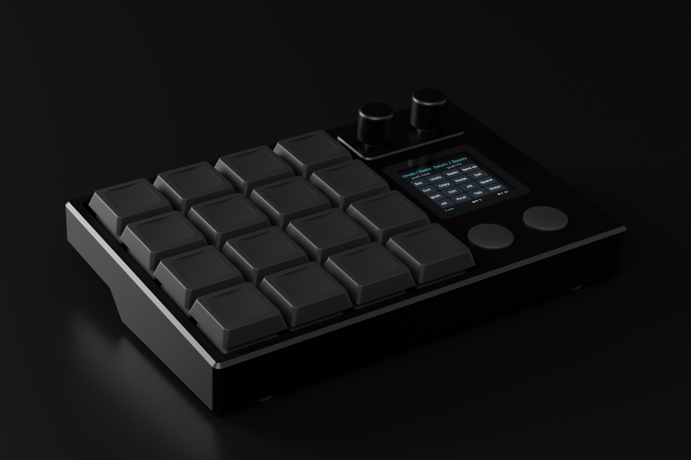

*A render of the case model, not a photo. The screen shows a drawing of what the firmware should display.*

> **Status: design files only. Nothing has been built, and the design is not finished.**
> The PCB is placed but not fully routed: 36 pads on 25 nets have no track. Two case checks fail. No order
> files for the board exist. No board has been ordered, no case printed or milled, and the firmware has never
> run on a chip. Every number below is what the design files and their automatic checks say. Read
> [Before you order](#before-you-order) first.

## Contents

1. [Status](#status)
2. [What it is](#what-it-is)
3. [Gallery](#gallery)
4. [Build one](#build-one)
5. [Stock keymap](#stock-keymap)
6. [Work on the design](#work-on-the-design)
7. [What is checked](#what-is-checked)
8. [Where things are](#where-things-are)
9. [Before you order](#before-you-order)
10. [Compared with the GLYF](#compared-with-the-glyf)
11. [License](#license)

## Status

Checked on 2026-11-13. The commands marked "run" were run on this repository for this table. The others are
copied from the last builder run and its report, named in the last column.

| Part | State | How it was checked |
| --- | --- | --- |
| Research and decisions | Done. Seven decision records, a parts summary, a reference dossier; 37 design decisions. | Read; [docs/decisions.md](docs/decisions.md) |
| Specification | Done. `board.toml`: outline, keys, controls, display, module, ports, battery, screws, stack-up, pin map, panel. | Run: `python3 tools/check_spec.py`, 91 of 91 pass |
| Circuit and schematic | Done. 107 parts, 74 nets, 61 machine-placed (31 LCSC codes). Generated KiCad 10 sheet. ERC: 0 errors, 0 warnings. 309 pins match the circuit. | Run: `make pcb-test`, 62 unit tests pass. ERC from the last `build.py schematic`, [pcb/README.md](pcb/README.md) |
| Pin map | Circuit and firmware agree with `board.toml`. | Run: `python3 tools/check_pins.py`, 0 circuit failures, 12 of 12 firmware checks |
| PCB layout | **Not finished.** All 107 parts placed on 4 layers. 1,141 tracks, 164 vias, **36 pads on 25 nets unrouted**. DRC: 0 errors, 39 unconnected, 0 schematic differences. No copper in the antenna keep-out. | Last `build.py place`; `pcb/routing.txt`, [pcb/README.md](pcb/README.md#checks) |
| Board order files | **Not written.** The build refuses an unfinished board. A draft run gave 61 placements in 30 BOM lines and a frame panel with 0 DRC errors. | Last `build.py fab-draft`; [pcb/README.md](pcb/README.md#checks) |
| Case | Model done, **2 checks fail**: the G1 and G2 screw tips end 0.15 mm short of the last full thread against 0.4 mm. 163 of 165 limit checks pass. 24 of 24 parts valid, 0 clashes in 666 (CNC) and 703 (FDM) part pairs. Self-test 22 of 22. | Last `build.py all` (exit 1); `cad/exports/checks.json`, [cad/README.md](cad/README.md#checks) |
| Firmware | Builds. ZMK 4dd95d78 on Zephyr 4.1.0. FLASH 391,252 B of 811,008 B (48.24 %), RAM 122,242 B of 262,144 B (46.63 %). UF2 is 782,848 B. | Last `bash firmware/build.sh`; [firmware/README.md](firmware/README.md#build) |
| Pictures | Done. 7 stills, the status screen and a 72-frame turntable; PCB and case pictures. The PCB pictures show the unfinished board. | Last `bash tools/render_all.sh`, exit 0 in 907 s |
| Order package | **Not ready.** Run with `--draft`: 34 files listed, 6 problems: knob and RF insert drawings missing (4), G1 and G2 thread (2). The full run (orders build, same day) also lists 11 missing PCB files. | Run: `python3 tools/order_package.py --draft`, exit 1; [production/README.md](production/README.md) |
| Documentation | Every path and anchor named in Markdown exists. | Run: `make docs-check`, see [What is checked](#what-is-checked) |
| Real hardware | **None.** No board, no print, no flash. | - |

`make test` (spec-check, docs-check, pin-check) exits 0. A passing check says the files agree with each other.
It says nothing about a real part.

## What it is

| | |
| --- | --- |
| Radio and MCU | u-blox BMD-340-A-R module (nRF52840), PCB trace antenna in a metal-free bay behind a POM insert in a 30 mm slot in the right wall |
| Keys | 16 Kailh Choc V2 class switches at 19.05 mm pitch, hot-swap sockets, 5 x 4 diode matrix (16 keys, 2 knob pushes, 2 buttons) |
| Knobs | 2 x Bourns PEC12R-4215F-S0024, 24 detents, push |
| Buttons | 2 x Omron B3FS-1000P under round caps |
| Display | 1.3 inch 240 x 240 IPS (ST7789V) on a 24-pin FPC, PWM backlight, painted PMMA lens |
| Storage | 16 MB QSPI NOR flash, reserved for icons; the firmware only puts it to sleep today |
| Power | 1,200 mAh LiPo with protection, TI BQ24072 charger with power path (about 400 mA), TPS7A02 3.3 V LDO, MAX17048 gauge, slide switch on the LDO enable |
| USB | USB-C receptacle, ESD array, 0.75 A PTC |
| PCB | 4 layers (In1 ground, In2 3.3 V), parts on both faces, built in a routed frame panel with mouse-bite tabs |
| Case | Two CNC 6061 shells, bead blast and black anodise; 128.4 x 85.2 mm, 20.6 mm at the wedge apex. An FDM PETG variant for a test print |
| Firmware | ZMK: 4 Bluetooth profiles, USB, ZMK Studio over USB and Bluetooth, 4 layers, own status screen. No clock and no widget channel yet |

More detail: [docs/hardware.md](docs/hardware.md).

## Gallery

Every picture is generated by the code in this repository. None is a photo.

### Renders

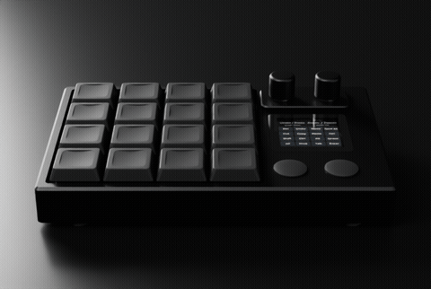

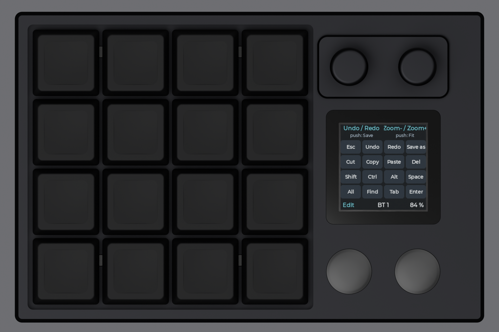 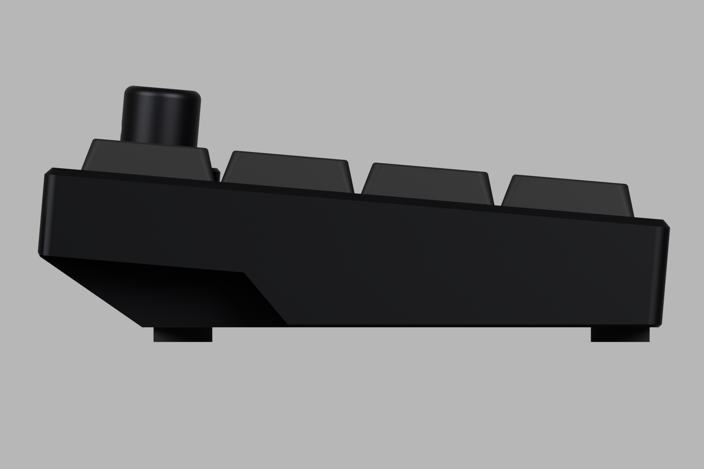

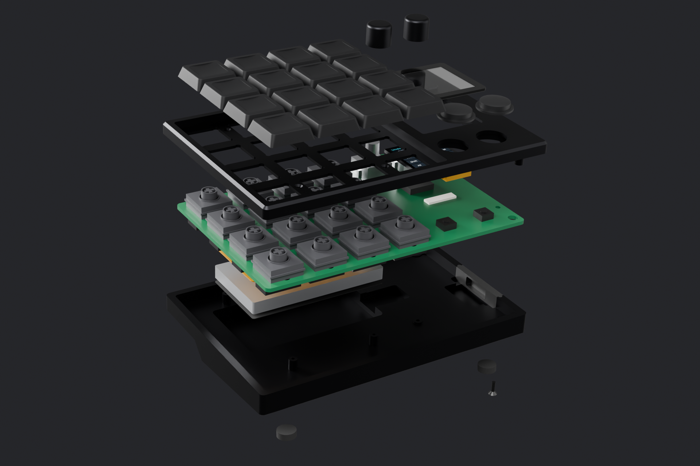 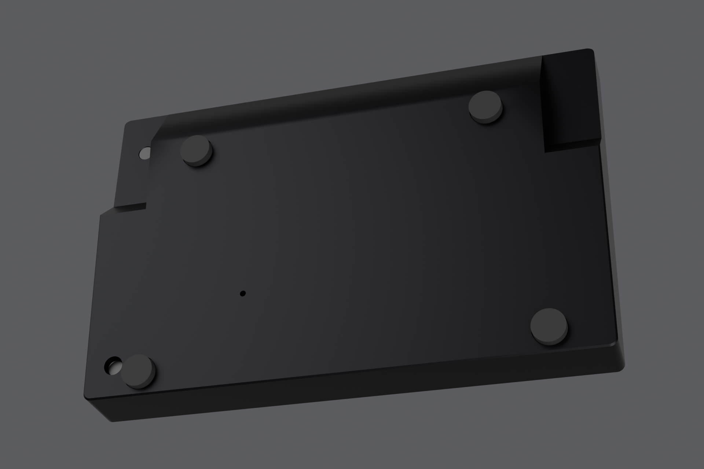

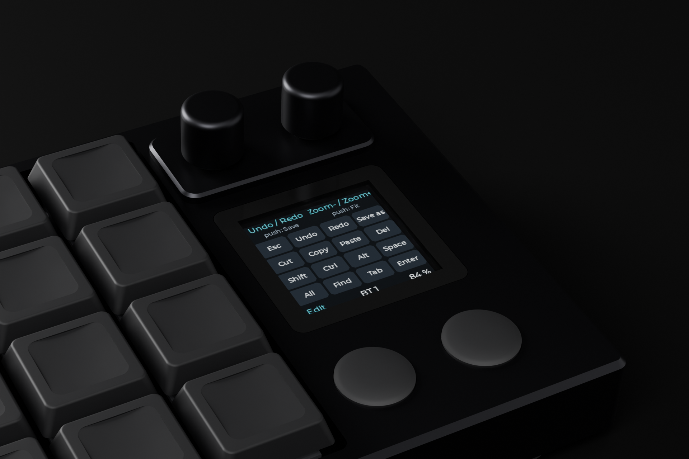 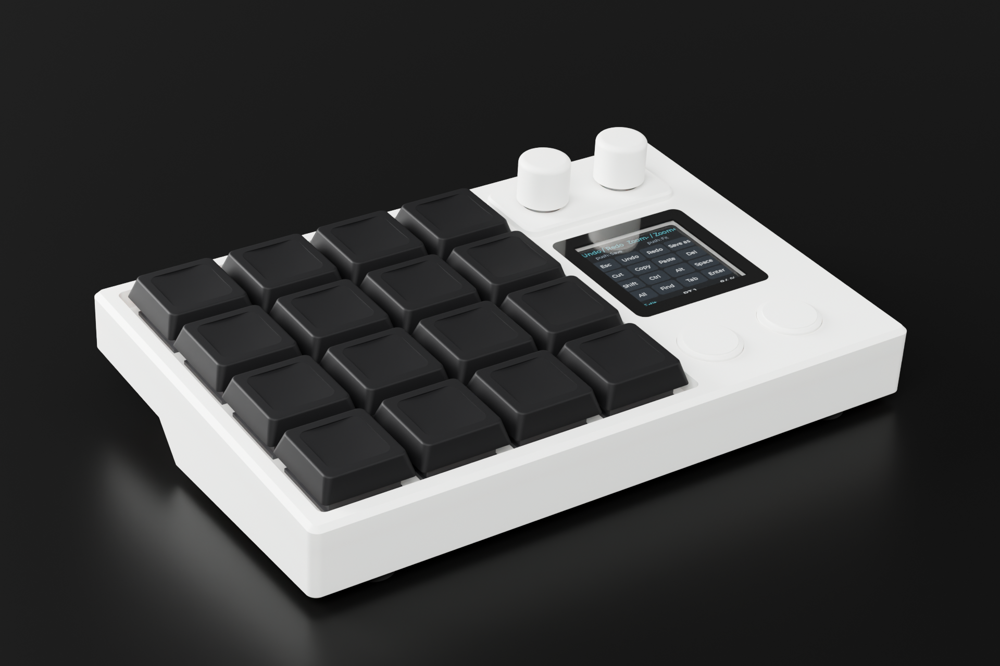

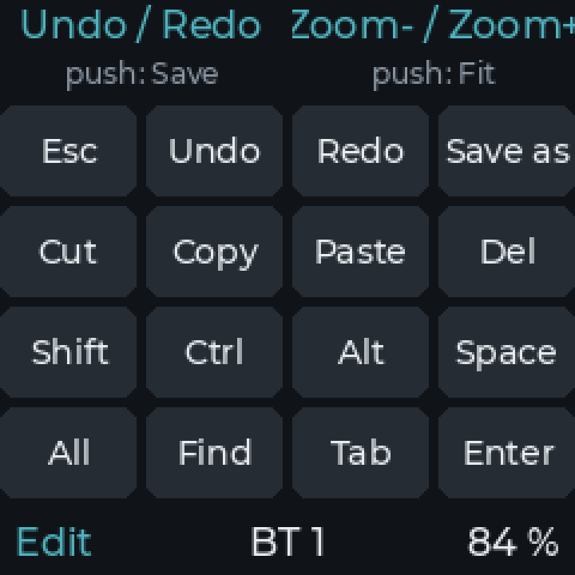

The status screen is drawn with Pillow from the layout and colours in the firmware source. It is not a
capture from a panel. Materials and colours are proposals. The PCB in these renders is the case package's
reference slab, because the finished board STEP does not exist yet. Turntable as
[MP4](docs/images/renders/turntable.mp4). How the renders are made: [tools/render/README.md](tools/render/README.md).

### PCB

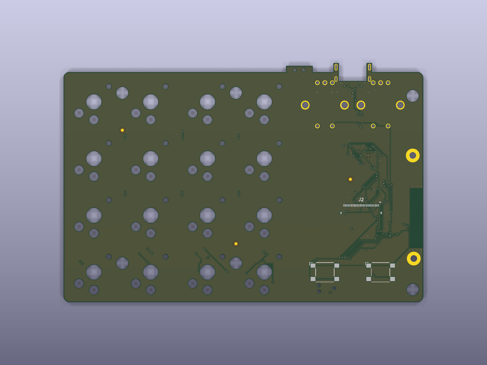 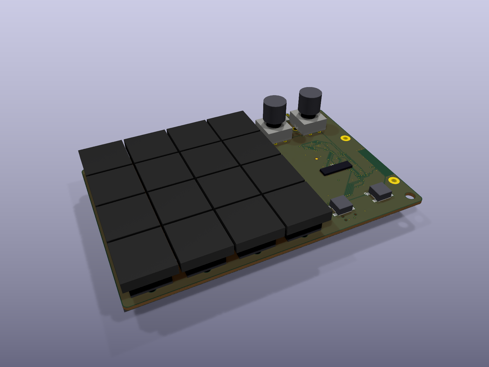

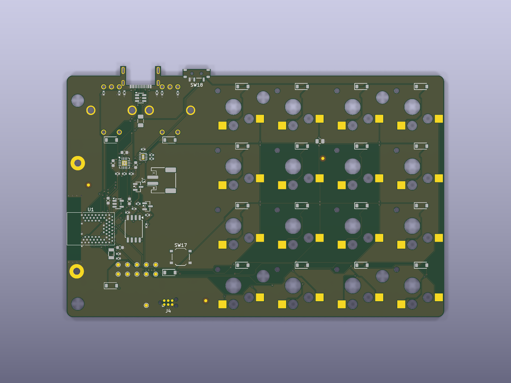 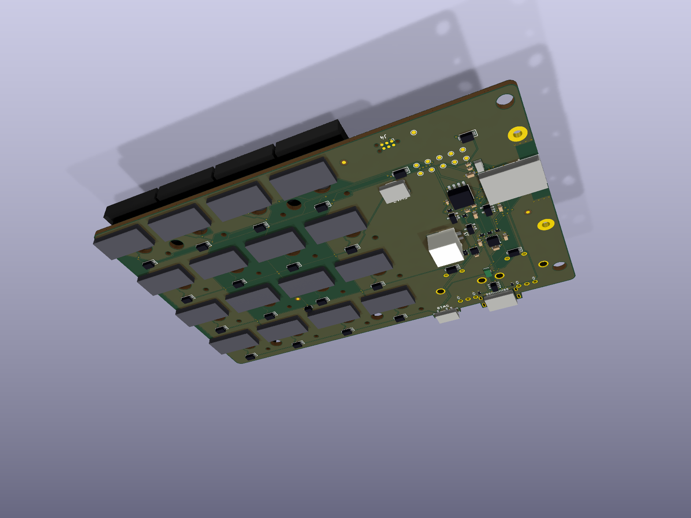

These show the **unfinished, partly routed** board. Parts are block models with nominal heights, not the
makers' 3D models.

Schematic as [PDF](docs/images/pcb/schematic.pdf). Copper layers: [top](docs/images/pcb/copper-top.svg),
[ground](docs/images/pcb/copper-ground.svg), [3.3 V](docs/images/pcb/copper-3v3.svg),
[bottom](docs/images/pcb/copper-bottom.svg). Assembly drawings: [top](docs/images/pcb/assembly-top.svg),
[bottom](docs/images/pcb/assembly-bottom.svg). Routing notes: [pcb/README.md](pcb/README.md).

### Case model

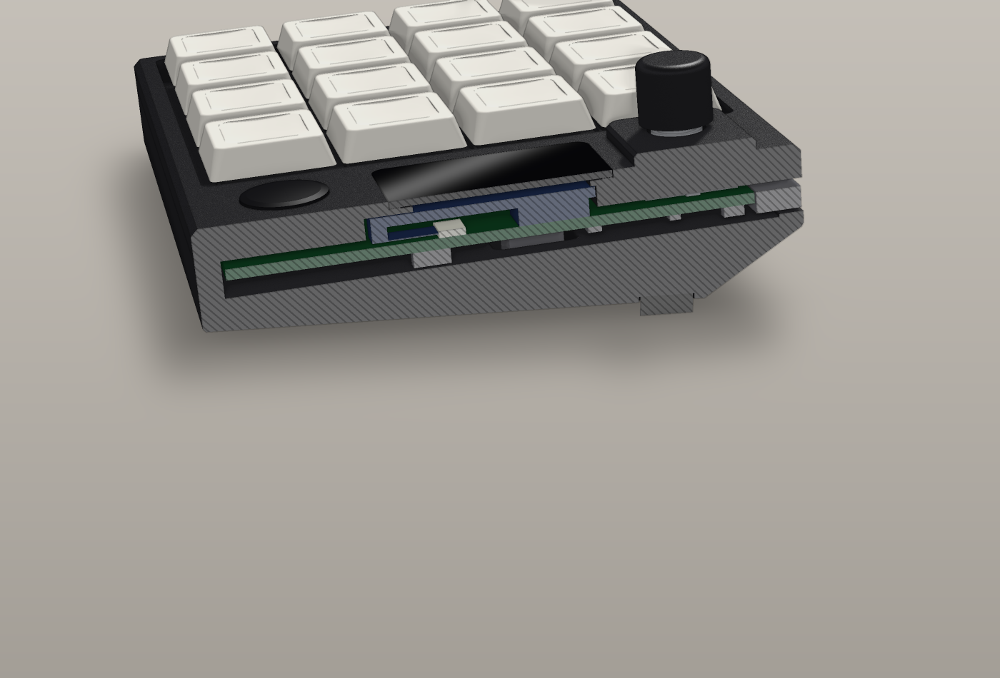 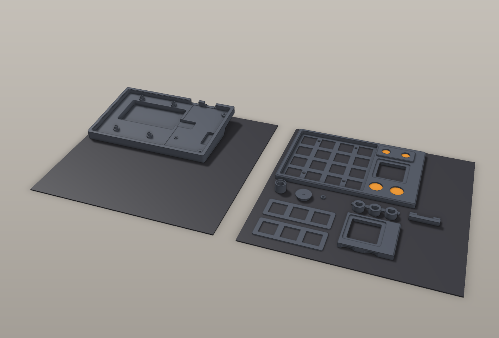

Quick pictures from the case package. The lens is drawn opaque here. More views and the checks:
[cad/README.md](cad/README.md). Machine-shop drawings are in `cad/exports/drawings/`.

## Build one

Nobody has done this yet, and it cannot be done today: the board is not routed. The guides are written from
the design files. Expect mistakes.

1. **Read [Before you order](#before-you-order).** Every gate there must be closed.
2. **Check the order package.** `make order` must exit 0. Its index is
   [production/README.md](production/README.md).
3. **Order the board.** [docs/ordering.md](docs/ordering.md): JLCPCB step by step, every form field with its
   reason. Fallback: [docs/ordering-pcbway.md](docs/ordering-pcbway.md). Buy what JLCPCB does not place:
   [docs/parts.md](docs/parts.md) and [docs/bom-hand.csv](docs/bom-hand.csv).
4. **Make the case.** Print the FDM prototype and the coupons first: [docs/printing.md](docs/printing.md).
   Then the CNC shells, knobs and RF insert at JLCCNC, the resin caps at JLC3DP and the lens:
   [docs/ordering-case.md](docs/ordering-case.md).
5. **Assemble, flash and test.** [docs/assembly.md](docs/assembly.md) follows the build order of
   [D28](docs/decisions.md#d28-build-order-cell-orientation-and-lead) with a bench test at each step.
   Switches go in on the printed insertion jig. [docs/flashing.md](docs/flashing.md): the bootloader once over
   SWD, then `firmware/dist/worxpad.uf2` by drag and drop.

## Stock keymap

Four layers. The right button steps Edit, Nav, Media. Hold the left button for System. The display shows the
knob functions and the 16 key labels of the active layer. Full tables: [docs/keymap.md](docs/keymap.md).

| Layer | Keys, row by row (rear row first) | Left knob: turn, push | Right knob: turn, push |
| --- | --- | --- | --- |
| Edit | Esc Undo Redo SaveAs / Cut Copy Paste Del / Shift Ctrl Alt Space / All Find Tab Enter | Undo, redo; Save | Zoom out, in; Fit |
| Nav | Home Up End PgUp / Left Down Right PgDn / Shift Ctrl Alt Tab / Bksp PrevTab NextTab Enter | Left, right; Space | Up, down; Enter |
| Media | Prev Play Next Mute / Vol- Vol+ Bright- Bright+ / F13 to F16 / F17 to F20 | Volume; Mute | Screen brightness; Play |
| System (hold left button) | Edit Nav Media StudioUnlock / BT1 BT2 BT3 BT4 / BTPrev BTNext BTClear USB-or-BT / USB BT Reset Bootloader | from the layer below | from the layer below |

Shortcuts use Ctrl. Change the keymap in ZMK Studio (unlock on System, row 1, column 4) or in the source
`.keymap` file.

## Work on the design

### Tools

| For | You need |
| --- | --- |
| Checks | Python 3.11 or newer, `make` |
| PCB | Docker. KiCad runs in the pinned image `kicad/kicad:10.0.7` through `pcb/kicad.sh`, with no network |
| Case | Python 3.12 and a venv in `cad/.venv` made with uv, build123d 0.13.0 ([cad/README.md](cad/README.md#build)) |
| Firmware | Docker. `zmkfirmware/zmk-build-arm` pinned by digest. The first build fetches the west modules (about 3 GB) |
| Renders | The case venv, Blender 5.2 and FreeCAD 1.1 as flatpaks, ffmpeg |

Images are pinned by digest in `tools/images.lock`; `bash tools/pull_images.sh <tag>` pulls one.

### Commands

Run `make help` for this list.

| Command | Does | State on 2026-11-13 |
| --- | --- | --- |
| `make test` | spec-check, docs-check, pin-check: everything checkable without Docker or hardware | exits 0 |
| `make pcb-test` | Circuit self-check and generator unit tests, no Docker | exits 0, 62 tests |
| `make pcb-place` | Schematic, placed and routed board, DRC, keep-out copper check, PCB pictures | exits 1 while pads are unrouted |
| `make pcb-fab` | Gerbers, drills, panel, JLCPCB and PCBWay files, board STEP | refuses the unfinished board |
| `make cad` | Case checks, STEP/STL/3MF exports, drawings, quick pictures (about 7 minutes) | exits 1 on the G1 and G2 checks |
| `make firmware` | ZMK build into `firmware/dist/worxpad.uf2` | exits 0 |
| `make renders` | Product renders into `docs/images/renders/` (about 15 minutes) | exits 0 |
| `make order` | Order index and CNC package, cross-checks of every order file | exits 1 by design until the gates close |

Rules for changing the design are in [CLAUDE.md](CLAUDE.md): change `board.toml` first, never hand-edit a
generated file, never weaken a check.

## What is checked

| Area | Check | Result (2026-11-13) |
| --- | --- | --- |
| Specification | `tools/check_spec.py`: keys on pitch, holes and parts inside the outline, no overlapping bodies in a shared Z range, pocket floors against the wedge, stack-up order, RF bay and keep-out, screw-post walls, pin map against the module pad table, 3V3 capacitance, panel and tabs, corner radii for JLCCNC, FDM bed fit | 91 of 91 pass |
| Circuit | `make pcb-test`: circuit self-check, router, schematic writer, footprints, pin map | 62 tests pass |
| Pins | `tools/check_pins.py`: 41 pin map entries, 15 spares and 24 FPC pins against the circuit; GPIOs, pulls, matrix, encoders, display bus and binding counts against the firmware | 0 failures; 12 of 12 |
| Schematic | `kicad-cli sch erc --severity-all`; KiCad's netlist against the circuit | 0 errors, 0 warnings; 309 pins match |
| PCB | `kicad-cli pcb drc --severity-all --schematic-parity`; copper in the antenna keep-out | 0 errors, **39 unconnected**, 0 parity; no copper |
| Case | `cad/build.py check`: self-test, validity, interference, clearances, CNC rules, FDM rules, RF metal, insertion jig | **163 of 165** limit checks pass; G1 and G2 thread fail |
| Firmware | `firmware/build.sh`: build, UF2 family 0xADA52840 at 0x26000 | pass |
| Orders | `tools/order_package.py`: files present, BOM against CPL, JLCPCB against PCBWay, case checks, hole list | **6 problems** with `--draft` |
| Docs | `make docs-check`: files, pictures and anchors named in Markdown exist | 627 paths in 46 Markdown files exist |

CI ([`.github/workflows/ci.yml`](.github/workflows/ci.yml)) runs `make test`. It has not run on GitHub yet.

## Where things are

| Path | Holds |
| --- | --- |
| [`board.toml`](board.toml) | Single source of truth: positions, stack-up, pin map, matrix, panel |
| [`docs/decisions.md`](docs/decisions.md) | Design decisions D1 to D37 |
| [`pcb/`](pcb/README.md) | The board. `gen/` is the generator (`circuit.py` is the circuit, `layout.py` the placement, `route.py` the routing, `fab.py` the order files), `kicad/` the generated KiCad 10 project, `lib/` footprints, symbols and block models |
| [`cad/`](cad/README.md) | Parametric case (build123d). `worxpad_case/` is the model and its checks, `exports/` holds STEP, STL, 3MF, drawings and `checks.json`, `production/` the JLCCNC package |
| [`firmware/`](firmware/README.md) | ZMK board, keymap, status screen and display power hook in `zmk/`; `build.sh`; `dist/worxpad.uf2` |
| [`production/`](production/README.md) | Generated order index and manifest |
| [`tools/`](tools/) | `check_spec.py`, `check_pins.py`, `check_docs.py`, `order_package.py`, `render_all.sh` and `render/`, pinned images |
| [`docs/hardware.md`](docs/hardware.md) | Circuit in words, pin map, power tree, layer stack, mechanical stack |
| [`docs/parts.md`](docs/parts.md) | Every part, its LCSC number, what to buy elsewhere, cost guesses |
| [`docs/ordering.md`](docs/ordering.md), [`docs/ordering-pcbway.md`](docs/ordering-pcbway.md), [`docs/ordering-case.md`](docs/ordering-case.md) | Ordering the board and the case, field by field |
| [`docs/printing.md`](docs/printing.md) | FDM prototype and coupons |
| [`docs/assembly.md`](docs/assembly.md) | Build order and bench tests |
| [`docs/flashing.md`](docs/flashing.md) | Bootloader over SWD, updates over USB |
| [`docs/keymap.md`](docs/keymap.md) | The stock keymap and how to change it |
| [`docs/reference-device.md`](docs/reference-device.md) | What is known about the GLYF; where worxpad differs |
| [`research/`](research/) | Finished research: `COMPONENTS.md`, `DOSSIER.md`, `components/`, `raw/` |
| `docs/images/` | Generated pictures: `renders/`, `pcb/`, `cad/` |

## Before you order

These are open. None is hidden by a green check.

**Gates: do not order until each is closed**

1. **PCB routing.** 36 pads on 25 nets are unrouted (list in `pcb/routing.txt`). The bottleneck is the control
   column between the charger, the flash and the module. Then `make pcb` must write the order files.
2. **VBUS on module pad 66 while 3V3 is off** is not read in the nRF52840 Product Specification
   ([D12](docs/decisions.md#d12-vbus-on-module-pad-66-while-the-rail-is-off)).
3. **G1 and G2 thread.** With 2.7 mm of thread and an M2 x 4 screw the tip ends 0.15 mm short of the last full
   thread, against 0.4 mm. A longer thread breaks the 2.0 mm metal rule. Needs a decision
   ([D6](docs/decisions.md#d6-two-ground-screws-with-the-enclosure-numbers), [cad/README.md](cad/README.md#open-items)).
4. **Knob and RF insert drawings** do not exist. The insert needs its length tolerance on paper, or it may come
   out longer than its slot.
5. **USB-C plug test.** Plugs with large overmolds may not seat in the 0.25 mm recess. A plug test gates the
   case order ([D37](docs/decisions.md#d37-usb-c-recess-kept-at-025-mm-pending-a-plug-test)).
6. **`make order` exits 0.** It cross-checks every file the vendors receive.

**Electrical**

- **3.3 V rail.** Panel VDD can reach 3.35 V against a 3.3 V recommended maximum
  ([D13](docs/decisions.md#d13-33-v-regulator-accuracy)). The 3V3 capacitance is 21.6 of 22 uF; whether the
  module holds one or two internal 4.7 uF capacitors is not confirmed with u-blox
  ([D14](docs/decisions.md#d14-capacitance-on-the-33-v-rail)).
- **Footprint numbers scaled from drawings (MEASURE):** BMD-340 inner-row step and 4.15 mm column, FH34SRJ
  pad inset, USB-C slot copper ring. Print each footprint 1:1 and lay the part on it. The MAX17048 exposed pad
  is not checked against Maxim's land pattern.
- **Encoder pins and J1.** Encoder pin rows at Y 7.60 collide with J1's shell slots; the layout works round it
  with 1.6 mm pads. The spec check does not catch it.
- **Copper at the board edge.** J1's signal pads and SW18's shield tabs touch the routed edge under a -0.1 mm
  clearance exception. Confirm with JLCPCB.
- **Fine rules.** 0.10 mm track and space everywhere (JLCPCB's 4-layer limit is 0.09 mm), vias under the
  module. The USB pair (D+ 56.2 mm, D- 54.0 mm) has no impedance calculation.
- **Placement rotations.** Only two rows of the JLCPCB rotation table come from a sibling; the rest are
  community values. Check every designator in JLCPCB's placement preview. Confirm the fiducials sit at least
  3.85 mm from the panel edge.
- **Encoder direction** follows KiCad's stock pattern. If a knob counts backwards, swap A and B in firmware.
- **Review.** The schematic and layout are generated and machine-checked. No engineer has reviewed them.

**Mechanical**

- **Antenna inset** depends on the +/-0.2 mm routed outline
  ([D24](docs/decisions.md#d24-antenna-inset-against-the-outline-tolerance)); ask JLCPCB for +/-0.1 mm.
- **Radio range in aluminium** is not measured. Foil-lined FDM pre-test, then a 3 m test on the first aluminium
  unit ([D11](docs/decisions.md#d11-top-shell-over-the-rf-slot)).
- **Small margins:** pocket floor 1.62 mm, G2 post to the RF pocket 1.20 mm, encoder tabs 0.15 mm per side,
  display pocket to RF pocket 0.80 mm, C2 spot-face to the foot 1.06 mm against a guessed 1.0 mm, CNC USB-C
  skin 0.60 mm (JLCCNC recommends 0.8 mm).
- **Switches go in on a printed jig** with the bottom shell off, because eight sockets sit over the cell
  ([D26](docs/decisions.md#d26-switches-go-in-on-an-insertion-jig)).
- **Battery lead.** Lead length (50 mm) and exit position are guesses. Measure the cell before fitting it.
- **Coupons first:** switch retention in the anodised lip, keycap stem fit, display flex fold, encoder in its
  plinth pocket, USB-C skin ([docs/printing.md](docs/printing.md#coupons-first)).
- **FDM supports** are needed under both flank scoops as well as the rear slope.
- **Guessed limits and sizes** are tagged in `cad/worxpad_case/spec.py` and `board.toml`: fits, wall and
  bridge limits, screw engagement, pilot holes, rib sizes.

**Firmware**

- **Bootloader.** The Adafruit bootloader 0.11.0 has no worxpad board header. Set its LED and DFU pins to spare
  pins before the first SWD flash ([docs/flashing.md](docs/flashing.md)).
- **Display.** The ST7789V init values are Zephyr's example set, not the panel maker's sequence. Orientation
  and offsets are guesses. The right knob label may be clipped on the screen.
- **Power.** Idle current (target 100 uA or less) and deep-sleep wake through the matrix are not tested.
- **USB IDs** are the pid.codes test pair `1209:0001`. Get your own before you give boards to others.
- **No clock and no widget channel.** The host time and Raw HID features of the research are not written.

**Supply and cost**

- **Hot-swap sockets** are not stocked at JLCPCB; buy them from a keyboard shop. Encoders, the module, the
  charger and the JST header are thin lines; check stock on the day ([docs/ordering.md](docs/ordering.md#before-you-order)).
- **No quotes.** Every cost in [docs/parts.md](docs/parts.md#cost) is a guess. Vendor form values were not
  re-read on the live forms.

## Compared with the GLYF

worxpad follows the GLYF's function set: 4 x 4 Choc V2 class keys at 19.05 mm, two knobs with push, two round
buttons, a 240 x 240 colour display behind a 31.2 mm lens, USB-C, Bluetooth to four hosts, a 1,200 mAh battery
and two CNC aluminium shells. The main differences:

| Item | GLYF | worxpad |
| --- | --- | --- |
| Body | 120.4 x 85.2 mm, 19.2 mm apex | 128.4 x 85.2 mm, 20.6 mm apex: room for the antenna bay and the cell |
| Radio | nRF5340 module with chip antenna, no radio window | nRF52840 BMD-340, machine-placed, PCB antenna behind a POM insert in the right wall |
| Display | 1.4 inch, printed glass | 1.3 inch, painted PMMA lens, PWM dimming |
| Clock | DS3231 RTC with coin cell | none; host time, not written yet |
| Bootloader | MCUboot | Adafruit UF2, drag and drop |
| Knob covers | two round bosses | one rounded-rectangle plinth |
| Keycaps | moulded PBT | own design, printed in resin |

Every row with its reason and decision link: [docs/reference-device.md](docs/reference-device.md#glyf-versus-worxpad).
GLYF facts come from public images and pages; nobody outside its maker has measured one.

## License

Code (scripts, generators): GPL-3.0-or-later, see [LICENSE](LICENSE). Hardware (board, case, drawings):
CERN-OHL-S-2.0, see [LICENSE-HARDWARE](LICENSE-HARDWARE). The ZMK files under `firmware/zmk` are MIT, as ZMK
is. Third-party material is listed in [THIRD_PARTY.md](THIRD_PARTY.md). The owner has to confirm this choice.

GLYF and Prota Designs are names of their owner. worxpad is not affiliated with them.
