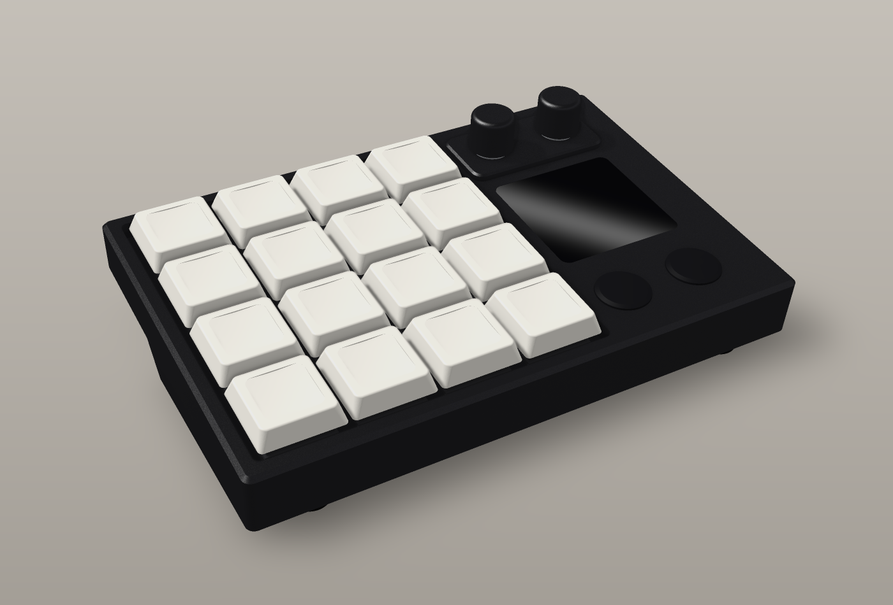
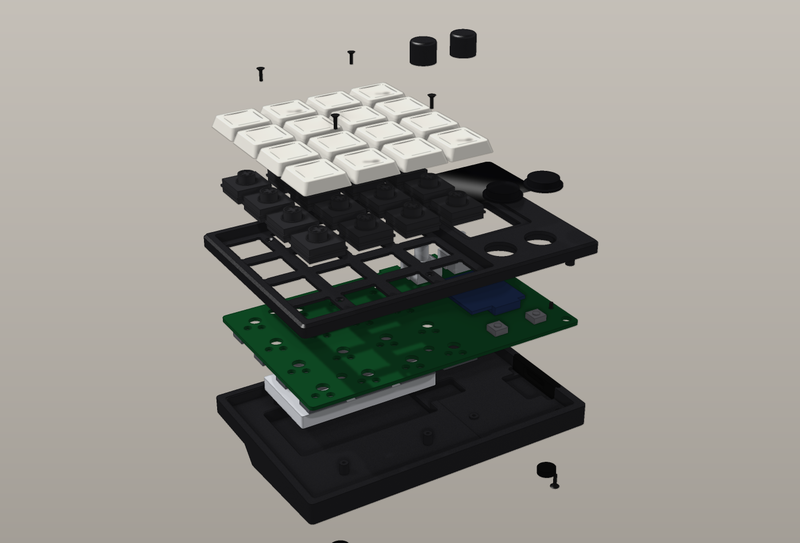
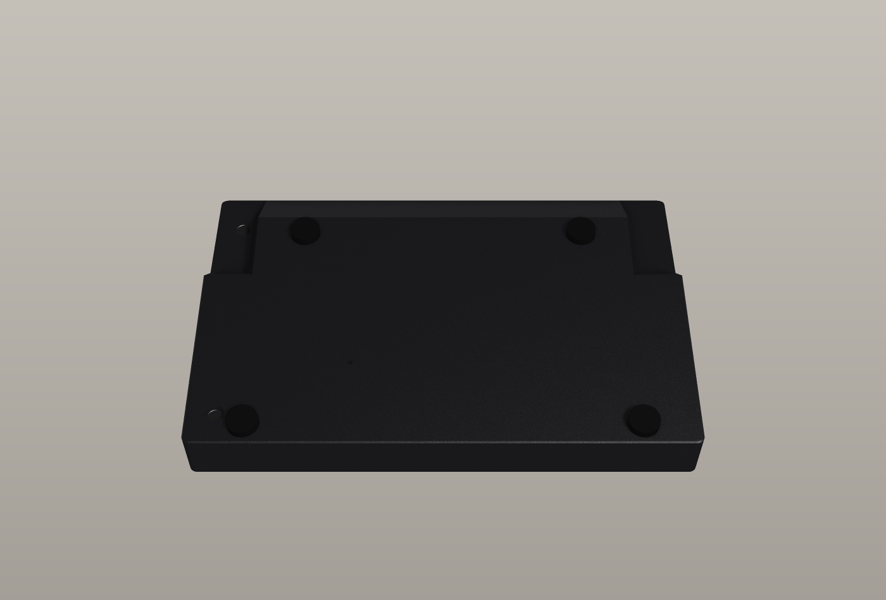
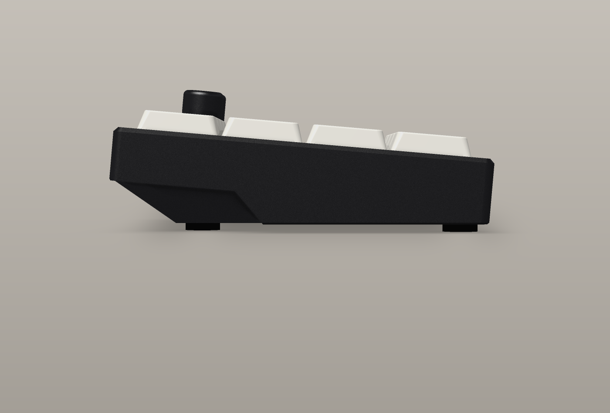
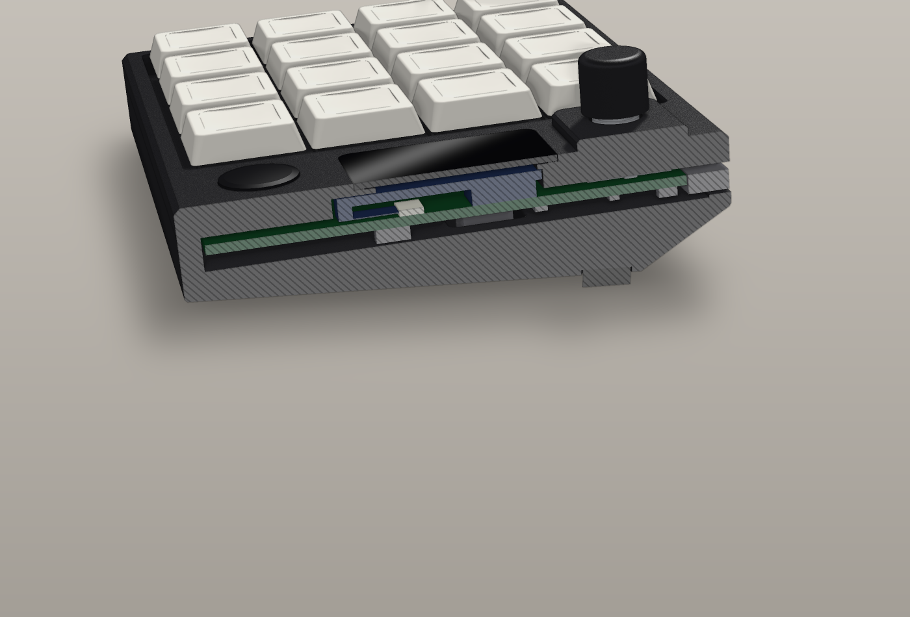

# Case

Parametric case for worxpad, written with build123d 0.13.0. Every position and level comes from
[`board.toml`](../board.toml); the case-only dimensions, each with its source, are in
[`worxpad_case/spec.py`](worxpad_case/spec.py).

> **Nothing here has been milled, printed or fitted.** The model passes its own checks, and that is all. The G1
> and G2 threads pass with a proposed bottoming tap that the owner has not yet confirmed: see
> [Open items](#open-items).



| | |
| --- | --- |
|  |  |
|  |  |

Quick pictures from the package's own renderer. Colours are proposals; the lens is drawn opaque, so the
display under it does not show. Bought parts are reference shapes, not vendor models.

## Build

```bash
cd cad
uv venv --python 3.12 .venv
uv pip install --python .venv/bin/python -e .
.venv/bin/python build.py all      # check, export, render, draw (make cad)
.venv/bin/python build.py check    # checks only; exits 1 on any failure (make cad-check)
```

## Parts

| Part | Made | Files |
| --- | --- | --- |
| Top shell: deck, key well, 1.15 mm Choc V2 plate lip, lens recess and 0.80 mm web, knob plinth, button holes, C and G posts | CNC 6061 (JLCCNC); FDM prototype | `exports/cnc/top_shell.step`, `exports/print/top_shell.*`, drawing in `exports/drawings/` |
| Bottom shell: tray with the wedge, flank scoops, battery pocket and relief, RF bay pocket and window slot, USB-C and switch notches, reset pinhole, foot pockets, K posts, C countersinks | CNC 6061; FDM prototype | `exports/cnc/bottom_shell.step`, `exports/print/bottom_shell.*` |
| RF window insert | POM, CNC | `exports/cnc/rf_insert.step`, drawing in `exports/drawings/` |
| Knob (2) | CNC with an M2 set screw; FDM with crush ribs | `exports/cnc/knob.step`, `exports/print/knob.*`, drawing and `knob_holes.csv` in `exports/drawings/` |
| Button cap (2) | Resin; FDM with a flat top | `exports/resin/button_cap.*`, `exports/print/button_cap.*` |
| Keycap (16): low, square, square spherical dish (keys 6.5) | Resin (JLC3DP) | `exports/resin/keycap.*` |
| Lens | 1.0 mm cast PMMA, laser cut | `exports/drawings/lens.dxf`, `exports/drawings/lens_mask.dxf`, `exports/lens.step` |
| Ground spacer (2) | FDM only | `exports/print/g_spacer.*` |
| Switch insertion jig (D26) | FDM | `exports/print/insertion_jig.*` |
| Coupons | FDM, stem coupon in resin | `exports/print/coupon_*`, `exports/resin/coupon_stem.*` |

`exports/assembly.step` holds the CNC case with every reference part. Printing: [docs/printing.md](../docs/printing.md).

## Modules

| Module | Holds |
| --- | --- |
| `spec.py` | board.toml, the case-only dimensions, the tapped-hole arithmetic, the check limits |
| `solids.py` | Small helpers in board coordinates |
| `parts.py` | Top and bottom shell, CNC and FDM |
| `small_parts.py` | Insert, knobs, button caps, keycap, lens, spacers, jig, print aids |
| `components.py` | Reference shapes of the bought parts |
| `coupons.py` | Coupons and the print pose of every printed part |
| `checks.py`, `measure.py`, `printsim.py`, `selftest.py` | The checks |
| `raster.py`, `render.py` | The software renderer and its views |
| `drawings.py`, `small_drawings.py`, `export.py` | Drawings, hole tables, DXF (shells; knob and RF insert); STEP, STL, 3MF |

`raster.py` and `printsim.py` are copied from the macropad case (same owner), with support zones and a
short-ledge rule added to `printsim.py`; `measure.py` and `selftest.py` are adapted from it.

## Checks

`build.py check` writes `exports/checks.json`. Its groups: a self-test of the measuring checks on known-bad and
sound solids; solid validity of every part; a pairwise clash check of the assembled stack, both variants;
named clearances; JLCCNC rules on both CNC shells; FDM rules on every printed part; the RF window and bay; the
insertion jig and its stability; and a fit check against the PCB STEP (pcb/production/worxpad-pcb.step) once the PCB
builder writes it (until then the PCB is drawn from board.toml). That check moves the STEP from KiCad's frame
(board bottom at Z 0) to pcb.bottom_z, checks the board thickness, and fails if the file holds the board body
alone, because then the part models were not exported. The results of the last run are in
[docs/printing.md](../docs/printing.md#what-the-checks-say) and in `exports/checks.json`.

Last run (`build.py all`, 2026-11-14): self-test 26 of 26; 24 of 24 parts sound; 666 pairs (CNC) and 703 pairs
(FDM) with no clash; 177 limit checks, 0 failures. The G1 and G2 rows pass with a proposed bottoming tap that the
owner has still to confirm (below). Selected CNC numbers:

| Check | Value | Limit |
| --- | --- | --- |
| Corner radius against depth (R >= H/10 + 0.5), R 1.5 table, sharp internal edges | 0 faults on both shells | 0 |
| Thinnest wall, top / bottom shell (sampled) | 0.80 / 0.60 mm (the USB-C skin) | 0.5 absolute |
| Named walls: display web, display to RF pocket, K countersink to opening | 0.80, 0.80, 0.876 mm | 0.8 |
| Thinnest floor of the bottom shell (battery pocket front) | 1.616 mm | 1.5 |
| Not cut by a 2.0 mm end mill, from above and below | 0.0 mm² | 0.3 |
| Tool reach, deepest arc over its tool | 1.75 / 1.77 x D | 5 |
| Metal within 5 mm of the antenna strip, Z -13.30 to -2.80 | 0.0 mm³ | 0.05 |
| K (M1.6) engagement, tip margin, metal beyond the drill point | 3.80 mm, 0.55 mm, 4.88 mm or more | 2.4, 0.4, 2.0 |
| C (M2) engagement, tip margin | 3.95 mm, 0.40 mm | 3.0, 0.4 |
| G (M2, bottoming tap) engagement, tip margin, metal beyond the drill point | 2.25, 0.45, 2.219 mm | 2.0, 0.4, 2.0 |
| Button flange to counterbore ceiling: nominal, worst tolerance stack | 0.60, 0.10 mm | 0.10 at worst |
| Encoder body (maximum) to pocket ceiling, depth +0.10/0 | 0.05 mm | 0.0 |
| Battery pocket and relief rim setback 0.05 below the rim (R0.5 gives 0.282) | 0.283 mm | 0.262 |
| Pressed keycap to switch, to plate and K heads | 0.35, 0.95 mm | 0.3 |
| Knob rim to plinth at 0.8 mm push | 0.30 mm | 0.30 |
| PCB outline to the walls | 0.30 mm | 0.30 |

Choices the checks forced, all in the model:

- The RF bay pockets of the CNC shells run 1.5 mm into the right wall, so their corners leave no metal within
  5 mm of the antenna strip (mcu-radio A4). The outer wall stays 2.0 mm there.
- A trench 3 mm wide runs along the inner side of the RF slot below the cavity floor; without it the slot's
  lower 1.4 mm ends in corners no mill reaches.
- The inner USB-C pocket has T-bone corners: an R1.0 corner came within 0.045 mm of the PCB tongue.
- The FDM USB-C opening has no skin (usb-io 6.2 item 5 fallback): see docs/printing.md.
- Print aids in the FDM top shell: break-away ribs and one-layer skins (docs/printing.md).

## Open items

- **G1, G2 thread: proposed, not decided.** A plug tap cannot meet both enclosure 6.4 rules in the G post: 2.7
  mm of thread leaves the M2 x 4 tip 0.15 mm short of the last full thread (rule 0.4), and 3.0 mm leaves 1.72 mm
  beyond the drill point (rule 2.0). The model now calls a bottoming tap: 3.0 mm full thread, 0.5 mm unthreaded
  run, drill 1.6 x 3.5 from the post end. That gives 0.45 mm tip margin and 2.22 mm of metal past the point, and
  departs from the enclosure 5 guideline of D/2 unthreaded run. The owner must record it in D6, and the shop
  must confirm a bottoming tap with a chamfer of 0.5 mm or less.
- **Button cap flange gap 0.60 mm,** not the 0.25 mm of rotary-buttons 6.6: at 0.25 a tall switch (+0.2), a tall
  resin cap (+0.2) and a shallow counterbore (-0.1) preload the plunger past its 0.15 mm minimum pretravel. The
  flange moved down on the cap; the cap top and the counterbore stay where board.toml puts them.
- **Encoder pocket ceiling** is 0.05 mm over the encoder body at its maximum height, so the drawing calls the
  pocket depth +0.10/0. Raising `plinth.pocket_ceiling_z` in board.toml would give more room.
- **Battery pocket and relief rims are R0.5** (power 14 rule 3), in the model and as a drawing note.
- **Display mask parallax, an estimate:** at 30 and 45 degrees off the deck normal the mask edge hides about
  0.31 and 0.90 mm of the active area (info rows in checks.json). Check on the lens coupon.
- K thread recomputed for M1.6 (D30): 4.8 mm full thread from the post top, tap drill 1.25 to 5.60 mm deep,
  engagement 3.80 to 4.25 mm, 0.55 mm tip margin, 4.88 mm or more metal beyond the drill point.
- The FDM bottom shell needs slicer supports under both flank scoops as well as the rear slope (D27 names the
  slope only).
- USB-C skin 0.6 mm: above JLCCNC's 0.5 mm absolute minimum, under its 0.8 mm recommendation. Ask on the DFM.
- Guesses: the encoder collar diameter, switch housing above the flange, the keycap's inner taper and post
  length, the C1 floor pad, the C2 post well, the reset pad, the jig rib size and rim width, the densities in the
  jig centroid check, the display glass depth, the FDM pilot and insert depths,
  and every FDM print limit. Each is tagged in `worxpad_case/spec.py`.
