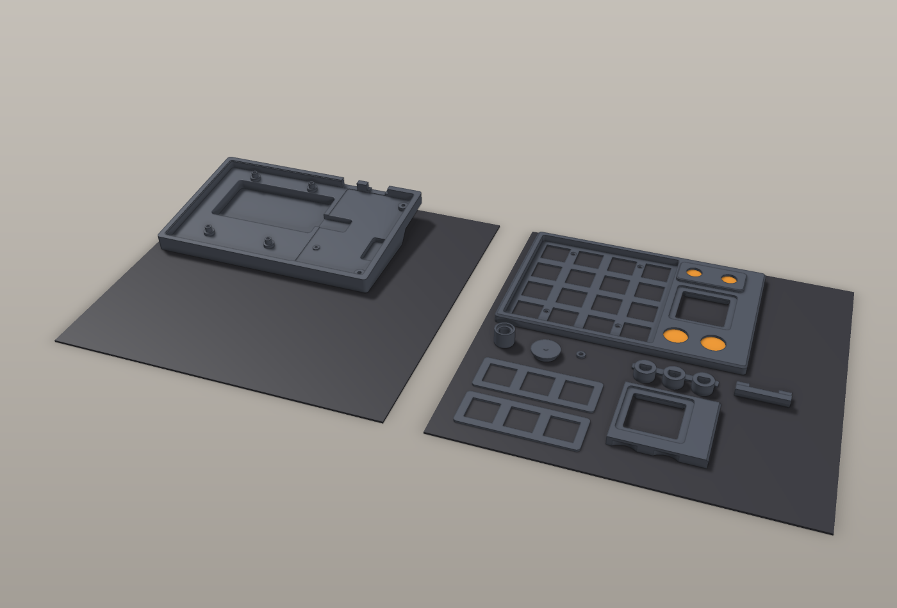

# Printing the FDM prototype

The local prototype of the worxpad case: PETG on a Bambu Lab A1 mini (180 x 180 x 180 mm bed), 0.4 mm
nozzle. It tests fit and use before the aluminium shells are ordered at JLCCNC.

> **Status: nothing has been printed.** The files below come from the model in `cad/` and pass its own checks
> (numbers in [What the checks say](#what-the-checks-say)). Every setting here is a starting point taken from
> the records or the sibling repositories, not a tested profile. Print the coupons first.

## What a print can and cannot validate

From [enclosure-manufacturing 8.3](../research/components/enclosure-manufacturing.md):

| Can | Cannot |
| --- | --- |
| PCB fit in the cavity and the outline | The radio through aluminium: the print is plastic everywhere |
| Switch retention in a plastic lip (the PG1353D class is drawn for plastic plates) | PG1353D retention in the 1.15 mm aluminium lip |
| Keycap, knob and button clearances; K heads flush in the cap gaps | Anodise build-up, bead-blast distortion of the lip and the 0.80 mm web |
| Stack heights and the 4.89 degree tilt on the feet | Case grounding (G1, G2 bond nothing in plastic) |
| Display window alignment, lens fit | Mass and feel, the cosmetic finish |
| Screw access and the build order of D28 | Tolerances tighter than about +/-0.2 mm, seam flatness |
| USB-C plug access and the power switch reach | The tapped-post fits, the CNC USB-C skin |
| Battery space against the wedge; the insertion jig | |

The plug test that gates the case order (D37 in [decisions](decisions.md)) runs on the print: try a set of
USB-C cables with large overmolds.

## Coupons first

Print and fit these before the shells. Each decides one number.

| File | What it decides | How |
| --- | --- | --- |
| `cad/exports/print/coupon_plate_1_0.3mf`, `cad/exports/print/coupon_plate_1_2.3mf` | Lip thickness (1.0 or 1.2 mm) and switch opening (13.9, 14.0 or 14.1 mm), keys 6.2 | Press a real switch into each opening. It must click in and hold under a keycap pull. The model uses 1.0 and 14.0; change `CASE.print_lip` in `cad/worxpad_case/spec.py` if the coupon says 1.2 |
| `cad/exports/print/coupon_knob_bore.3mf` | Knob bore 6.10, 6.20 or 6.30 mm with the crush ribs, rotary-buttons 6.5 | Push each section on a PEC12R shaft. It must hold without a tool and come off by hand. The model uses 6.20 |
| `cad/exports/print/coupon_usb.3mf` | USB-C opening and the PCB tongue | Fit the assembled PCB's receptacle and plug cables in. Prints on its rear face |
| `cad/exports/print/coupon_lens.3mf` | Lens recess, web, display pocket | Drop in the 31.2 mm lens and the display module. Includes its two break-away ribs |
| `cad/exports/resin/coupon_stem.stl` | Keycap cross slot (1.30 to 1.45 mm) and post diameter (5.00 to 5.40 mm), keys 6.5 | Resin at JLC3DP with the keycaps, not FDM |

## Parts, files and orientation

The 3MF and STL files already lie the way they print. The STEP files keep the assembly position.

| Part | Count | File | On the bed | Supports and aids |
| --- | --- | --- | --- | --- |
| Top shell | 1 | `cad/exports/print/top_shell.3mf` | Split face down, deck and knob plinth up (enclosure 8.2) | No slicer supports. The file holds its own aids, see below |
| Bottom shell | 1 | `cad/exports/print/bottom_shell.3mf` | Ramp plane on the bed, one piece with the wedge (D27) | Slicer supports under the rear slope **and under both flank scoops** (see below) |
| Knob | 2 | `cad/exports/print/knob.3mf` | Top face down | None |
| Button cap | 2 | `cad/exports/print/button_cap.3mf` | Top face down | None. The print cap has a flat top; the resin cap has a 0.3 mm crown |
| Ground spacer | 2 | `cad/exports/print/g_spacer.3mf` | Flat | None. 1.2 mm tall, between the PCB top and the G inserts |
| Switch insertion jig | 1 | `cad/exports/print/insertion_jig.3mf` | Plate down | None (D26) |
| Keycap | 16 | `cad/exports/resin/keycap.stl` | Resin at JLC3DP | Not an FDM part |

Both shells fit one 180 mm bed each; small parts and coupons fit beside the top shell.

### Print aids in the top shell file

Drawn in orange in the picture. They print with the part and come off before assembly:

- Two ribs 0.6 mm thick under the front ledge of the display web, at X 96.0 and 105.6. Without them that ledge
  would bridge 26.65 mm. Cut them off flush with a knife; they sit where the display module goes.
- One rib across each button counterbore, under a 0.2 mm skin. Without it the 17 mm counterbore ceiling is a
  bridge over the 15 mm limit.
- One 0.2 mm skin closing each knob shaft hole (8.4 mm) and each button hole (12.5 mm) at the ceiling of its
  pocket, so the ceiling prints as a closed bridge. Drill or cut the four skins out (8.4 mm and 12.5 mm).

### Supports under the bottom shell

D27 asks for supports under the rear slope only. The model check says the two flank scoops need them too:
each scoop is open at the side face and at the rear face, so its roof hangs from two edges, not between two.
Set the slicer to supports from the build plate only, under the rear slope (board Y 0 to 15) and under both
scoops (13 mm wide, board Y 0 to 35). The check counts these areas as carried. The rear slope stands 34.7
degrees to the bed and its finish will be rough; the prototype accepts that.

## Settings

From [conventions 5.2](../research/raw/conventions.md) and enclosure 8.1. Nothing here is tuned on this printer.

| Setting | Value |
| --- | --- |
| Material | PETG (PLA for a quick fit check) |
| Layer height | 0.2 mm; knobs and button caps 0.12 to 0.16 mm |
| Walls | 3 to 4 |
| Infill | 15 to 20 % gyroid |
| Top and bottom layers | 5 |
| Plate | Textured PEI for a matte face |
| Elephant's foot compensation | 0.15 mm (macropad value, a guess here) |
| Bottom shell supports | Build plate only, as above |

Horizontal faces of the shells sit on 0.2 mm layers where the board allows it: the print lip is 1.0 mm, the
lens recess 1.2 mm and the web 0.8 mm (web underside Z -2.00 against -1.95 in aluminium, so the display module
hangs 0.05 mm lower on its tape and the foam takes it).

## Inserts and screws

| Item | Count | Where |
| --- | --- | --- |
| CNC Kitchen M2 x 3 heat-set insert (hole 3.2 x 3.5 mm) | 4 | Top shell split face at C1, C2, G1, G2 |
| M1.6 x 8 countersunk self-tapping screw (D30) | 4 | K1 to K4, from the top into the bottom-shell bosses (1.3 mm pilot, a guess for PETG) |
| M2 x 10 DIN 7991 | 2 | C1, C2, from below into the inserts; both seats are spot-faced to Z -12.2 in print |
| M2 x 4 ISO 7045 pan head | 2 | G1, G2, through the printed spacer into the inserts (holds the PCB, no grounding) |
| 3M Bumpon SJ5076 | 4 | Foot pockets, as in the CNC case |

Press the inserts with a soldering iron and an insert tip, straight, flush with the split face. The iron
temperature is not set by any record; follow the insert maker's PETG value.

## How the print differs from the CNC case

- Plate lip 1.0 mm with its underside on the split face; nothing of the top shell hangs below the split.
- C and G posts are replaced by inserts in the top shell; C goes through 6.0 mm bosses in the bottom shell.
- K posts are 6.0 mm bosses under the PCB with a 3.6 mm post through it, for self-tapping M1.6 x 8.
- No RF slot and no POM insert: the right wall is solid plastic.
- The USB-C opening has no 0.6 mm skin. The 0.8 mm print skin of usb-io 6.2 item 6 would leave 0.15 mm to the
  PCB tongue at Y 0.95, under the 0.30 mm wall gap; the print uses the usb-io 6.2 item 5 fallback and the
  receptacle prongs show in the opening.
- Knob bore 6.20 mm with three crush ribs and no set screw; the CNC knob takes an M2 set screw.

## Assembly

Follow the build order of D28 in [decisions](decisions.md). For the print: press the inserts first, clear the
print aids and skins, put a ground spacer on each G insert before the PCB, and insert the switches on the
printed jig with the bottom shell off and the cell unplugged (D26). The top shell stands deck up on the jig's
rim, which runs under its split face along all four walls; the ribs only back the sockets. Do not let the
PCB carry the shell on the G screws while you press switches in.

## What the checks say

Copied from `cad/exports/checks.json` after `cad/build.py all` on 2026-11-14. The model checks say the geometry agrees
with its rules; they say nothing about a real print.

Self-test 26 of 26; 703 pairs of parts in the assembled print variant, 0 clashes (the knob crush ribs overlap the shaft by 0.451 mm³ each, as drawn). Bottom shell with supports under the rear slope and the scoops; top shell and lens coupon with their print aids.

| Part | Largest extent (max 180) | Longest bridge (max 15) | Deepest cantilever (max 1.5) | Thinnest wall (min 0.8) |
| --- | --- | --- | --- | --- |
| top shell | 128.4 | 14.2 | 1.3 | 0.8 |
| bottom shell | 128.4 | 7.8 | 0.8 | 0.897 |
| knob | 10.5 | 0.0 | 0.1 | 0.99 |
| button cap | 15.0 | 0.0 | 1.131 | 0.8 |
| ground spacer | 4.6 | 0.0 | 0.0 | 1.147 |
| plate coupon, 1.0 lip | 60.2 | 0.0 | 0.0 | 1.0 |
| plate coupon, 1.2 lip | 60.2 | 0.0 | 0.0 | 1.2 |
| knob bore coupon | 42.0 | 0.0 | 0.0 | 1.0 |
| USB-C coupon | 25.6 | 0.0 | 0.1 | 3.5 |
| lens coupon | 45.3 | 10.2 | 1.265 | 0.8 |
| insertion jig | 128.4 | 0.0 | 0.0 | not measured |

| Clearance | Value (mm) | Limit (mm) |
| --- | --- | --- |
| keycap to well wall | 1.4 | min 0.8 |
| pressed keycap to shell and K heads | 0.95 | min 0.3 |
| pressed keycap to switch | 0.35 | min 0.3 |
| knob rim to plinth pressed | 0.3 | min 0.3 |
| cell to pocket walls | 1.0 | min 1.0 |
| display module to top shell | 0.1 | min 0.1 |
| lens to recess | 0.1 | min 0.1 |
| PCB outline to bottom shell | 0.3 | min 0.3 |
| K self-tap engagement | 3.9 | min 3.2 |
| C insert engagement | 2.8 | min 2.5 |
| C tip to insert hole end | 0.25 | min 0.1 |
| G insert engagement | 1.05 | min 1.0 |
| jig rib to socket min | 0.2 | min 0.2 |
| jig clash with shell and pcb | 0.0 | max 0.05 |
| jig: shell and PCB centroid inside the rim | 41.088 | min 5.0 |
| button flange to counterbore ceiling, worst stack | 0.1 | min 0.1 |
| encoder body to pocket ceiling | 0.05 | min 0.0 |
| battery pocket rim setback (R0.5) | 0.283 | min 0.262 |
